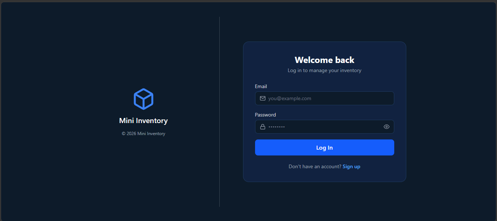
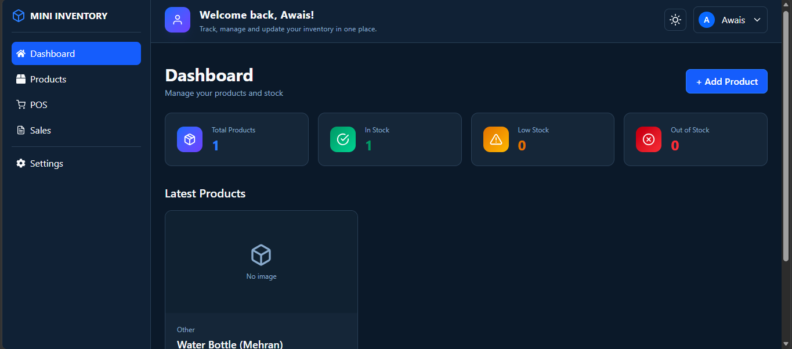
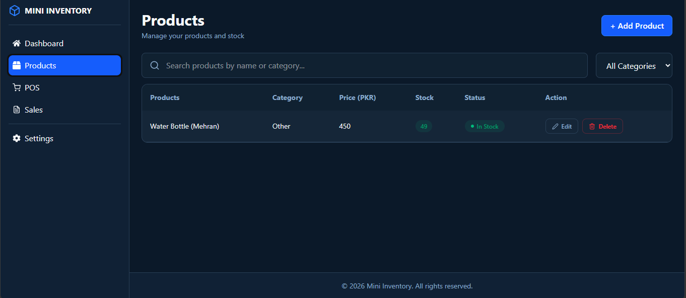
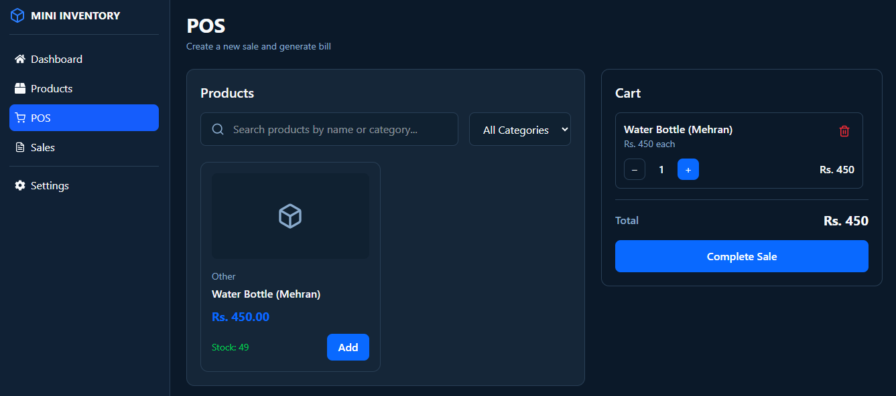
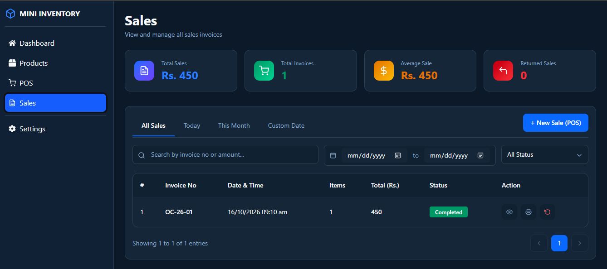
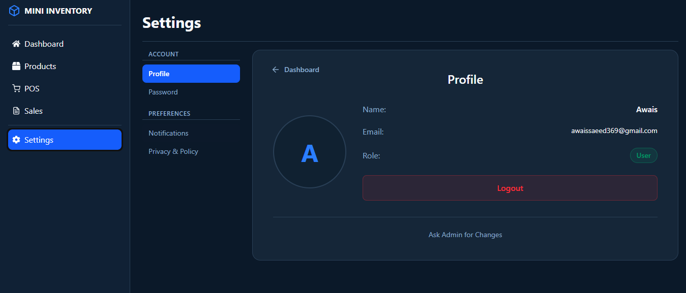
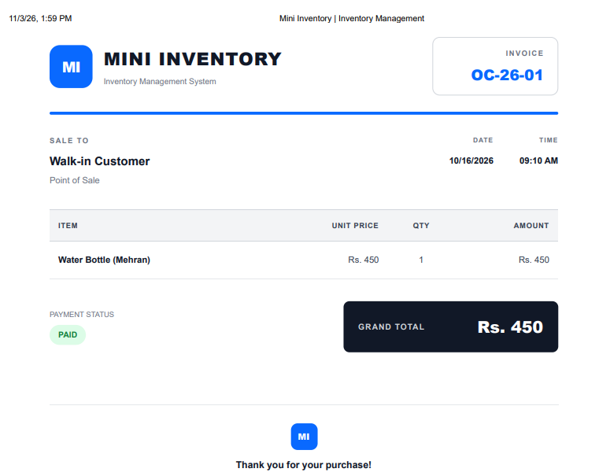

# Mini Inventory Manager

A full-stack inventory management web application built with React and Node.js. It allows businesses to manage their products, process sales through a built-in POS system, and track invoices — all from a clean, dark-themed dashboard. The app supports secure user authentication, real-time stock updates, and printable sale receipts.

---

## Screenshots

### Login


### Dashboard


### Products


### POS


### Sales


### Settings


### Receipt


---

## Tech Stack

**Frontend**
- React 19
- React Router v7
- Tailwind CSS v4
- React Icons
- Vite

**Backend**
- Node.js
- Express 5
- mysql2
- bcrypt
- dotenv

**Database**
- MySQL (Railway)

---

## Features

- 🔐 User authentication (Signup / Login)
- 📦 Product management — Add, Edit, Delete
- 🔍 Search and filter products by category
- 🛒 POS system with cart and real-time stock updates
- 🧾 Printable sale receipts
- 📊 Sales history with invoice tracking
- ↩️ Sale return with automatic stock restore
- 🌙 Dark / Light theme toggle
- 📱 Responsive design

---

## Pages

| Page | Description |
|---|---|
| **Login** | Secure entry point with email and password authentication |
| **Dashboard** | Overview of total, in-stock, low-stock, and out-of-stock products |
| **Products** | Full product listing with search, filter, edit, and delete |
| **POS** | Sales screen — add products to cart and complete sale |
| **Sales** | Sales history with date filters, invoice view, print, and return |
| **Settings** | Profile, change password, notifications, privacy |

---

## Project Structure

```
Inventory-Manager/
├── client/               # React frontend
│   └── src/
│       ├── pages/        # All page components
│       ├── components/   # Shared + POS components
│       └── config.js     # API base URL
├── server/               # Node.js backend
│   ├── app.js            # Express app entry
│   ├── config/db.js      # MySQL connection + schema setup
│   └── routes/routes.js  # All API endpoints
└── images/               # Project screenshots
```

---

## API Endpoints

| Method | Route | Description |
|---|---|---|
| POST | `/signup` | Register new user |
| POST | `/login` | Login |
| GET | `/profile/:id` | Get user profile |
| POST | `/change-password` | Change password |
| POST | `/add-product` | Add product |
| GET | `/add-product` | Get all products |
| PUT | `/product/:id` | Update product |
| DELETE | `/product/:id` | Delete product |
| POST | `/complete-sale` | Complete a sale |
| GET | `/sale/:id/items` | Get sale details |
| GET | `/sales` | Get all sales |
| POST | `/return-sale/:id` | Return a sale |

---

## Database Schema

```sql
users       (id, name, email, password)
products    (id, name, category, price, stock, image, created_at)
sales       (id, total, returned, created_at)
sale_items  (id, sale_id, product_id, product_name, price, quantity)
```

---

## Getting Started

### Prerequisites
- Node.js
- MySQL

### Backend Setup
```bash
cd server
npm install
```

Create a `.env` file in `server/`:
```
DB_HOST=your_host
DB_PORT=3306
DB_USER=your_user
DB_PASSWORD=your_password
DB_NAME=your_database
```

```bash
npm start
```

### Frontend Setup
```bash
cd client
npm install
```

Create a `.env` file in `client/`:
```
VITE_API_URL=http://localhost:3000
```

```bash
npm run dev
```

---

## Deployment

- **Database:** Railway MySQL
- **Backend:** Railway Web Service
- **Frontend:** Railway Static Site
